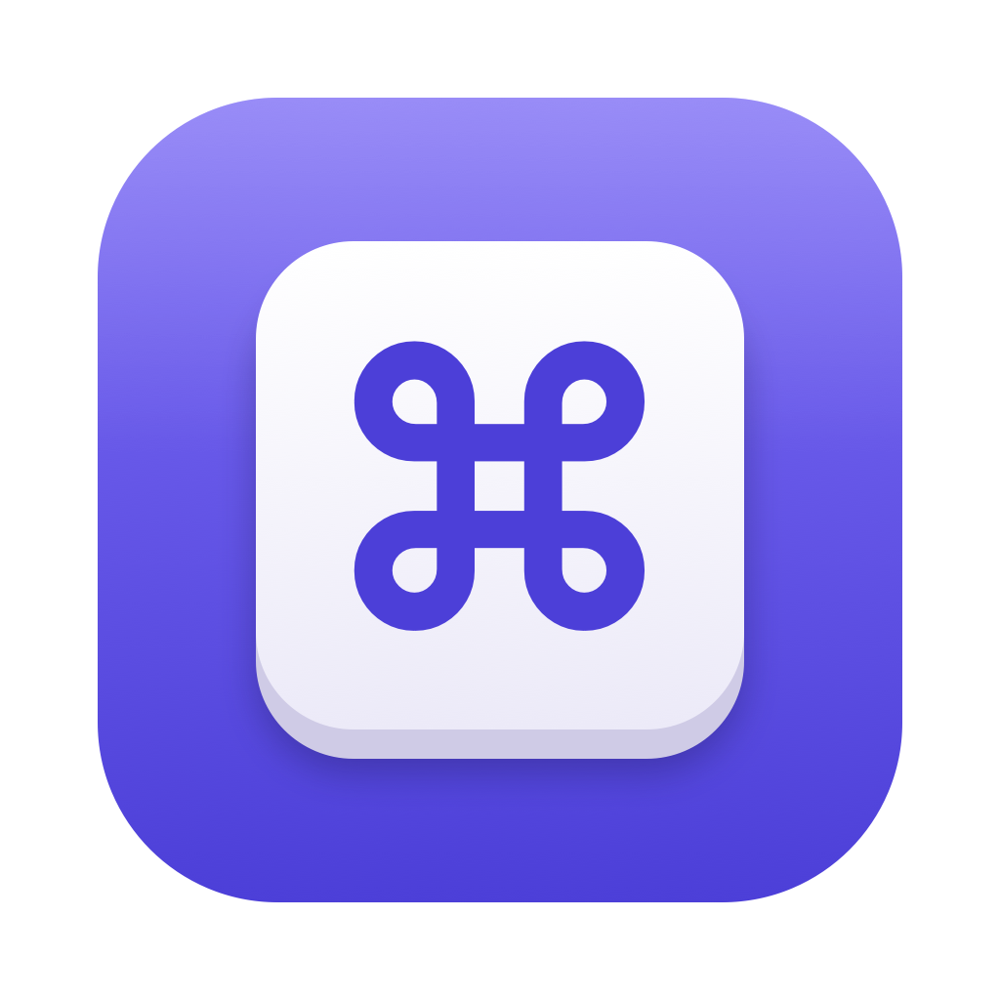
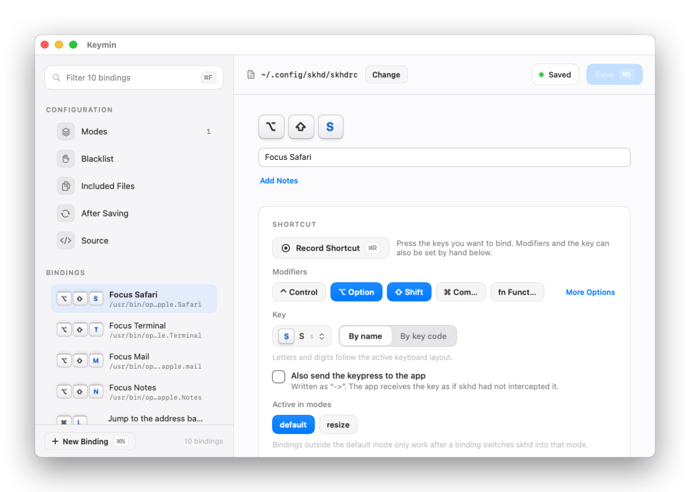

<p align="center">
  <a href="https://min.tools/keymin"></a>
</p>

<h1 align="center">Keymin</h1>

<p align="center"><strong>Hotkeys for skhd, without the syntax.</strong></p>

<p align="center">
  Edit your <a href="https://github.com/asmvik/skhd">skhd</a> hotkeys in a native Mac app. Record a shortcut, choose a command, or set different commands for each app. Keymin writes skhd syntax and keeps your comments and unchanged statements.
</p>

<p align="center">
  <a href="https://min.tools/keymin">Website</a>&nbsp;&nbsp;|&nbsp;&nbsp;
  <a href="https://min.tools/keymin/support/">Support</a>&nbsp;&nbsp;|&nbsp;&nbsp;
  <a href="PRIVACY.md">Privacy</a>&nbsp;&nbsp;|&nbsp;&nbsp;
  <a href="docs/development.md">Build</a>&nbsp;&nbsp;|&nbsp;&nbsp;
  <a href="docs/architecture.md">Architecture</a>
</p>

<p align="center">
  
  
  
  
  
  
</p>

<p align="center">
  <picture>
    <source media="(prefers-color-scheme: dark)" srcset="docs/images/hero-dark.png">
    
  </picture>
</p>

- **Every binding in plain language**  
  The sidebar lists each shortcut as key caps, named by the comment above it. Filter by key, name, command, app, or mode.
- **Record instead of typing**  
  Press **⌘R**, then the keys. Keymin records the modifiers and key. You can also choose a named key such as `return` or enter an Apple key code such as `0x27`. Keymin adds or removes the `fn` modifier as skhd requires.
- **Commands, per-app commands, and modes**  
  Open an app, run a shell command, set per-app commands, or switch to another mode. Commands can span several lines; Keymin joins them for skhd. Modes, the blacklist, and included files each have their own page.
- **Your file stays yours**  
  Unchanged statements keep their original text. Keymin preserves comments and blank lines, with some whitespace cleanup. It converts Windows line endings to plain line feeds so skhd does not pass carriage returns to the shell. Invalid lines stay in the file and are marked as errors. See [Architecture](docs/architecture.md) for formatting and validation details.
- **Asks before losing work**  
  Before you quit, open or create another file, or forget file access, Keymin offers to save your changes, including any editable Source draft.
- **Links and dotfiles work**  
  Point Keymin at `~/.config/skhd/skhdrc` even when it is a symbolic link into a repository. Keymin may ask once for access to the file the link points to. The link is kept, and that file is updated with its permissions intact.
- **Source when you want it**  
  The Source page shows the exact text Keymin will write. Edit it there for anything the forms do not cover. Your text is applied when you click Apply, save, leave the page, or make any other change.
- **Sandboxed and offline**  
  Keymin edits only the configuration you choose, never runs its commands, and makes no network connections of its own.
- **Run a shortcut after saving**
  With hot loading enabled, skhd reloads saved changes automatically. For other actions, such as restarting skhd, Keymin can ask Shortcuts to run a named shortcut after each save, passing the saved file's path.

## Get started

1. Open Keymin and choose your `skhdrc`, usually at `~/.config/skhd/skhdrc`, or create a new one.
2. Pick a binding, or press **⌘N** for a new one and **⌘R** to record its shortcut.
3. Write the command and press **⌘S**.

> [!NOTE]
> Keymin requires an Apple silicon Mac with macOS 14 or later. It edits the configuration; skhd runs the hotkeys.
>
> Install and start either [skhd](https://github.com/asmvik/skhd) (`brew install asmvik/formulae/skhd`) or [skhd.zig](https://github.com/jackielii/skhd.zig) (`brew install jackielii/tap/skhd-zig`). Both read the same configuration format. Keymin's first screen checks for installation files and a running skhd process.
>
> With hot loading enabled, saved changes apply automatically. If you use `--no-hotload`, run `skhd --reload` after saving, or set up a Shortcuts action on Keymin's **After Saving** page.

## What Keymin understands

| skhd syntax | In Keymin |
| --- | --- |
| `alt + shift - a : command` | Modifiers, key, and command |
| `cmd - d [ … ]` | Per-app commands with pass-through for other apps |
| `cmd - x ; resize` and `resize < escape ; default` | Mode switches and mode-scoped bindings |
| `:: resize @ : command` | Modes with capture and an on-enter command |
| `->` | Also send the keypress to the app |
| `lcmd`, `ralt`, `hyper`, `meh`, `fn` | Side-specific and combined modifiers |
| `0x27`, `f1`, `sound_up` | Key codes, named keys, and media keys |
| `.blacklist [ … ]` and `.load "file"` | Blacklist and included files |
| `# comment` above a binding | The binding's name and notes |

Per-app commands go on separate lines. For example, this binding runs a command in Safari and passes the key through in other apps:

```skhd
cmd - d [
    "Safari" : echo "Safari shortcut"
    * ~
]
```

The parser follows skhd's syntax rules. It flags errors such as lowercase hex digits in a key code (`0x2c` instead of `0x2C`). [Architecture](docs/architecture.md) covers parsing, validation, and command formatting.

## Private by design

Keymin has no advertising, analytics, account system, or developer server, and it has no network entitlement. Its app container holds the security-scoped bookmarks that reopen the chosen file, the trial state, and a few settings such as the After Saving option. Read [Privacy](PRIVACY.md) for the details.

## One app, two ways to use it

**Mac App Store:** The free download includes 30 days of full access. No subscription starts, and you are not charged. After the trial, you can view and edit the first five bindings. The others stay in the file and become visible again with Pro, available as a yearly subscription or a lifetime purchase.

Modes, the blacklist, included files, and After Saving remain editable in Free. The Source page requires Pro. Renaming a mode updates all its binding references, including hidden ones.

Existing errors in hidden bindings or unparsed lines do not block a Free save. New errors caused by your edits still do, including removing a mode used by a hidden binding. See [Architecture](docs/architecture.md) for how Keymin distinguishes these cases.

**Build from source:** This repository holds the public app source. A source build starts the same 30-day trial on a local clock after the first-launch notice; the Mac App Store build counts from Apple's signed original acquisition date. Both apply the same five-binding limit, StoreKit checks, and post-trial banner. See [Build and test](docs/development.md).

If Keymin helps you, [contribute](CONTRIBUTING.md) to its development.

## Documentation

| Guide | What it covers |
| --- | --- |
| [Build and test](docs/development.md) | Source and App Store builds, tests, generated assets, and source export |
| [Architecture](docs/architecture.md) | Build, file-access, interface, syntax, localization, and appearance boundaries |
| [Privacy](PRIVACY.md) | Local data, retention, and controls |

## License

Copyright 2026 [Ilia Ross](https://github.com/iliaross). The source is available under the [PolyForm Strict License 1.0.0 with added permissions for personal modification and contributions](LICENSE). You may inspect, build, and run it for noncommercial purposes, modify it for your own personal, noncommercial use, and prepare a contribution to the official repository under the [contribution terms](CONTRIBUTING.md). The repository license does not otherwise permit distributing the source, modified copies, or binaries. The Min Tools name, the Keymin name, and the Keymin icon are not licensed. The Mac App Store build follows Apple's [standard EULA](https://www.apple.com/legal/internet-services/itunes/dev/stdeula/).
